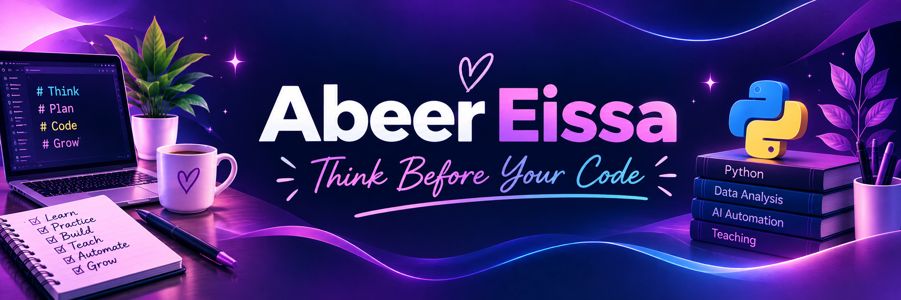

  

# Hi, I'm Abeer Eissa! 👋💜

### 👩‍🏫 Computer Science Lecturer | Python Trainer

🎓 MSc in Computer Science

🐍 Passionate about Python & Interactive Learning

🤖 Exploring AI Automation with n8n

---

### ✨ My Mission

Making programming easier for beginners through
computational thinking, practical exercises,
and interactive learning experiences.

---

---

## 🚀 Featured Projects

### 🐍 Interactive Python Learning Platform

An interactive learning platform designed to help
beginners learn Python through hands-on practice.

✨ **Key Features:**
- Interactive Python code editor
- 38 practical coding exercises
- 34 quiz questions
- 9 learning modules
- Hints and progress tracking

🎬 Includes a demonstration video and screenshots.

👉 [Explore the Project](https://github.com/AbeerPythonAndJava/interactive-python-learning-platform)

---

## 🛠️ Technical Skills

**Programming:** Python • Java • Scratch

**Core Concepts:** OOP • Problem Solving • Computational Thinking

**Data Analysis:** Pandas • NumPy

**Currently Exploring:** AI Automation with n8n
