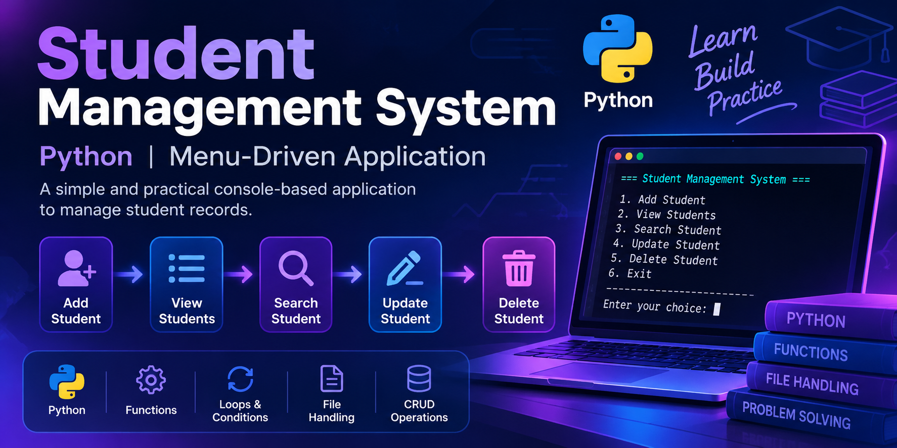

  

# Hi, I'm Abeer Eissa! 👋💜

### 👩‍🏫 Computer Science Lecturer | Python Trainer

🎓 MSc in Computer Science

🐍 Passionate about Python & Interactive Learning

🤖 Exploring AI Automation with n8n

---

### ✨ My Mission

Making programming easier for beginners through
computational thinking, practical exercises,
and interactive learning experiences.

---

## 🛠️ Technical Skills

**Programming:** Python • Java • Scratch

**Core Concepts:** OOP • Problem Solving • Computational Thinking

**Data Analysis:** Pandas • NumPy

**Currently Exploring:** AI Automation with n8n

---

## 🚀 Featured Projects

### 🐍 Interactive Python Learning Platform

An interactive learning platform designed to help beginners learn Python through hands-on practice.

✨ **Key Features:**
- Interactive Python code editor
- 38 practical coding exercises
- 34 quiz questions
- 9 learning modules
- Hints and progress tracking

🎬 Includes a demonstration video and screenshots.

👉 [Explore the Project](https://github.com/AbeerPythonAndJava/interactive-python-learning-platform)

---

### 🤖 AI Student Registration & Notification System

An AI-powered student registration prototype built with n8n, Google Gemini, Google Sheets, and Gmail.

🎬 [View Project & Demo](https://github.com/AbeerPythonAndJava/AI-Student-Registration-Automation)

---

### 🔐 ECC Email Encryption — Python

An educational cryptography project originally developed in Java and later reimplemented in Python using modern cryptographic techniques.

**Technologies:** Python | X25519 | HKDF | AES-GCM

📂 **Publicly available:** Python source code, a command-line interface, an educational ECC module, unit tests, and setup documentation, published under the MIT license. The original Java implementation is not included in this repository.

👉 [Explore the Python Source & Documentation](https://github.com/AbeerPythonAndJava/ecc-email-encryption)

---

## 🎓 Student Management System — Python

A menu-driven Python application developed as an educational project for beginner programming students.

**Key Concepts:** Python | Functions | Loops | Conditions | File Handling | CRUD Operations

🚧 **Project Status:** Code review and improvements in progress.

---
